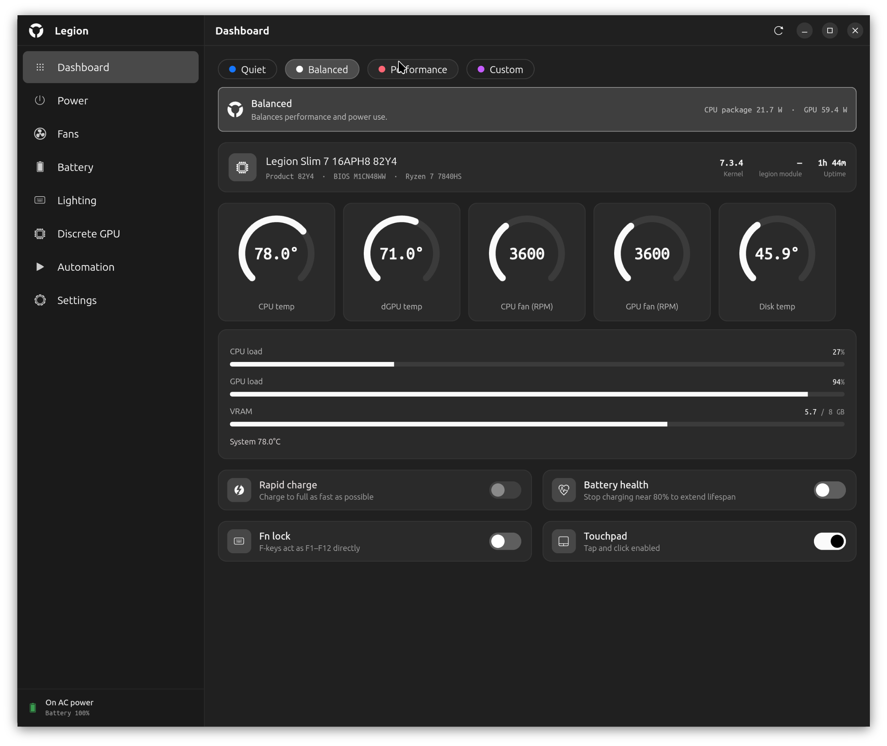
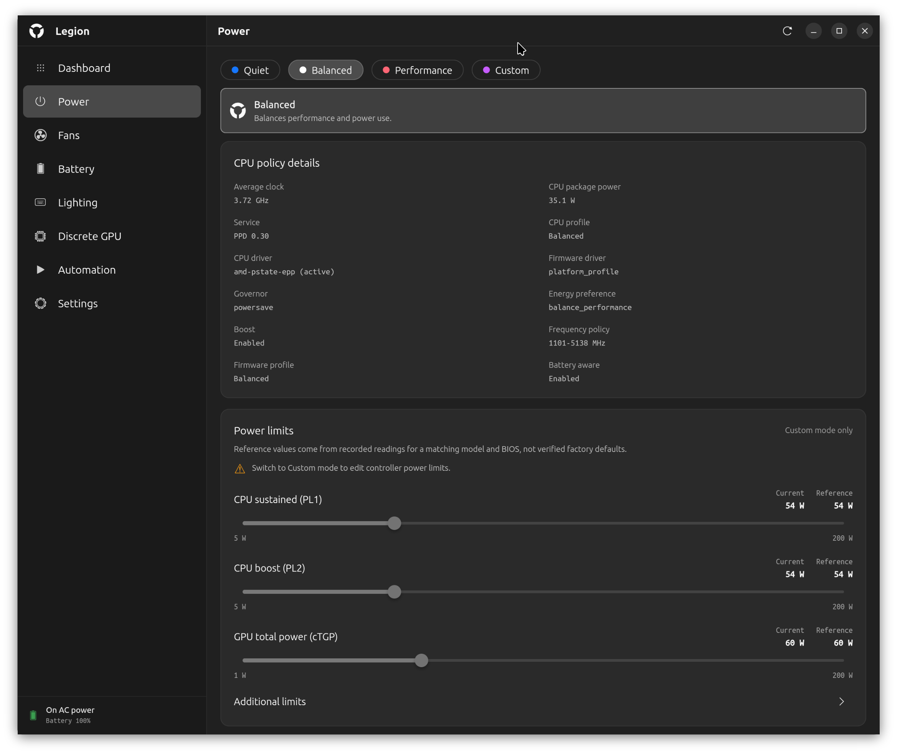
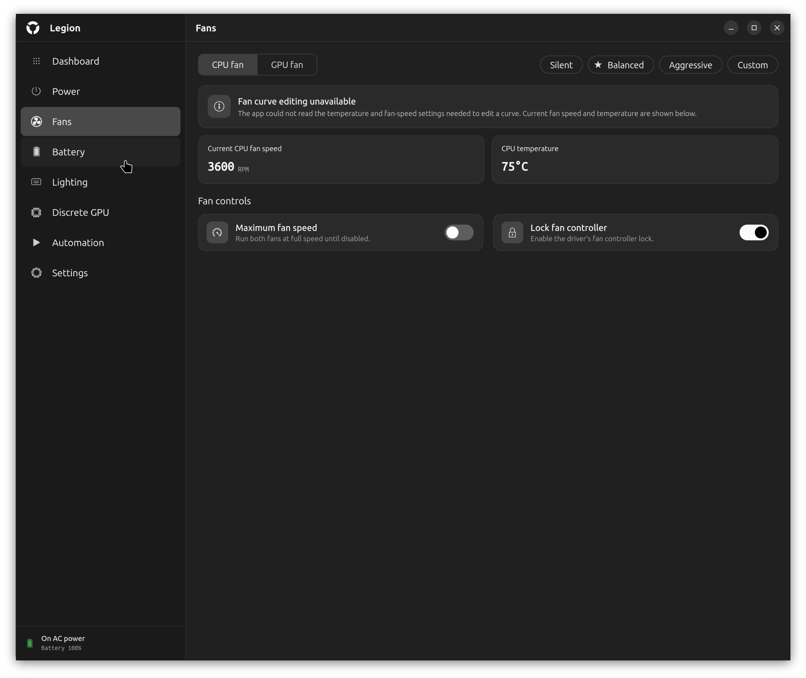
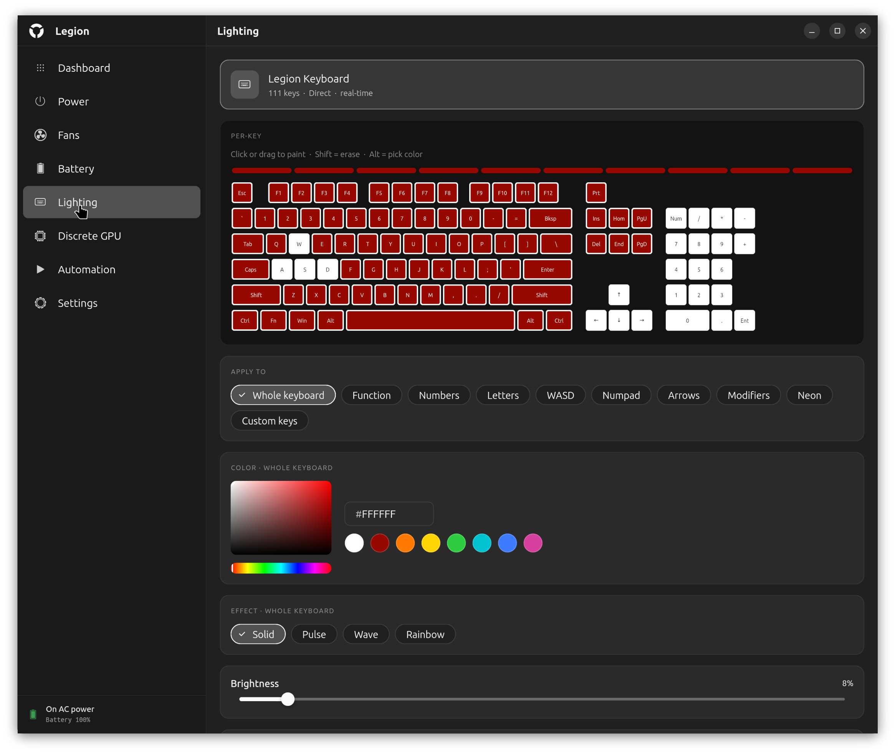
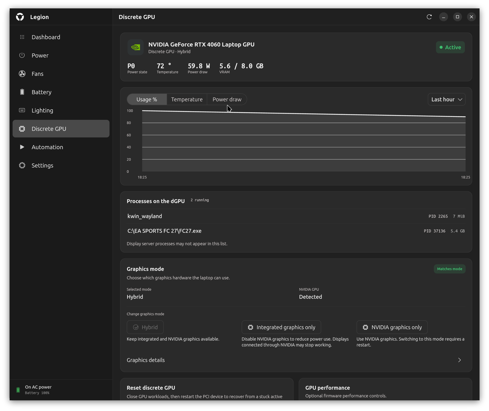

# Legion Linux Frontend

A Linux desktop app for controlling Lenovo Legion laptops with [LenovoLegionLinux](https://github.com/johnfanv2/LenovoLegionLinux).

**In development, with only one physical device used for development and testing:**
the project owner's **Legion Slim 7 16APH8 (82Y4, BIOS M1CN48WW)**. Not every
feature has been verified even on that laptop. Other models and BIOS versions
have not been tested. See [model support and recorded checks](docs/model-support.md).

## Help wanted

Much of this app is AI-generated code. I need as much help as I can get with the
backend and system interactions.

If you see something wrong, or the model making code more complicated than it
needs to be (it does that a lot), please
[open an issue](https://github.com/Prn-Ice/LenovoLegionLinuxFrontend/issues/new/choose).
If something is broken on your Legion, please open an issue too.

## Screenshots

Captured with Spectacle on my Legion Slim 7 16APH8.



<details>
<summary>Power, fans, lighting, and GPU screenshots</summary>

### Power



### Fans



### Lighting



### Discrete GPU



</details>

## Features and readiness

Summary reviewed on **2026-11-11** against code and recorded evidence; no new
hardware checks were performed for this review. “Implemented” means the app has
the feature, not that every hardware path is verified. We do not yet claim any feature is
complete across Lenovo Legion models.

| Feature | Current state | Remaining limits |
| --- | --- | --- |
| Fan curve editor | Editor, presets, and hardware-write path implemented | Correct curve reporting and write/readback validation still need driver work on the test device. Fan RPM readings have been checked separately. |
| Power modes | Mode selection and supported power-limit controls implemented | A controlled CPU PL1 write/readback/restore passed on the test device; other limits need validation. Verified factory-default restoration is not ready. |
| Battery conservation and rapid charging | Both controls implemented; Dashboard and Battery share confirmed state. Conservation on/off write and readback verified on the test device | Rapid-charging writes still need hardware verification. |
| Fn-lock and touchpad controls; camera status | Controls and read-only camera status implemented; Fn-lock write/readback/restore verified | Touchpad writes still need recorded hardware checks. The camera status file is absent on the test device; camera control is not supported. |
| Boot logo customization | Image upload and restore paths implemented | Applying a logo, restoring it, and checking the next boot still need recorded hardware verification. |
| Discrete GPU monitoring | NVIDIA runtime state, compute-process list, and graphics-mode status implemented | Graphics switching is still being validated; Hybrid Auto is intentionally unavailable as a desktop action. Process killing and PCI restart are not supported by the control service. |
| [Keyboard lighting profiles for each power mode](docs/keyboard-automation.md) | Saved profiles and automatic mode-based switching implemented; hardware-free native app journeys cover persistence and restart | The app must stay open. These journeys do not verify physical keyboard behavior; visual polish remains. |
| Keyboard lighting through Spectrum HID or OpenRGB | Both backends implemented | Native Spectrum currently targets USB `048d:c987` with the Gen 7/8 protocol. Other keyboards need device-specific verification; OpenRGB depends on its device support and setup. |
| Real-time dashboard | Periodically refreshed telemetry and quick controls implemented | Available readings depend on the driver and hardware. Read-only fan, power, and battery checks exist for the test device, not a multi-model test matrix. |

See the **[public backlog](BACKLOG.md)** for work in progress, known gaps, and
ways to help.

## Requirements

### Build and test

- Flutter stable 3.50.0 ([dependency notes](docs/dependencies.md))
- CMake, Ninja, a C/C++ compiler, and pkg-config
- GTK 3 and C++ standard-library development files
- GLib/GIO development files for native services
- Polkit development files for the temporary helper

See [Contributing](CONTRIBUTING.md) for installation commands.

### Hardware features

- Supported `legion_linux` kernel module
- Administrator-controlled `legion_cli` installation
- Systemd and the temporary helper bundled with the app
- Polkit and a desktop authentication agent
- NVIDIA drivers for NVIDIA dGPU features

The app uses the temporary helper for hardware changes. The first privileged
action requests desktop approval; closing the app ends the helper session.
On NixOS, enable Polkit and install the CLI in the system profile:

```nix
security.polkit.enable = true;
environment.systemPackages = [ pkgs.lenovo-legion ];
```

## Running

Hardware controls discover `legion_cli` in fixed host locations. The temporary
helper checks root ownership before executing privileged commands. Persistent
service management and next-boot graphics changes are unavailable through the
helper. Optional power telemetry and keyboard access need their own host setup.
On NixOS, use the [native Nix package](docs/nix.md):

```bash
nix run .#frontend
```

The Nix package supplies its library dependencies. The AppImage bundles its
desktop libraries and uses host graphics and core system libraries. On NixOS,
enable standard AppImage support as described in the
[AppImage instructions](docs/appimage.md), then run:

```bash
appimage-run ./legion-frontend.AppImage
```

See the [Debian package](docs/debian.md),
[AppImage build and trial instructions](docs/appimage.md), or
[run tests with synthetic hardware](CONTRIBUTING.md#test-without-hardware).

```bash
flutter run -d linux
```

Or build a release binary:

```bash
flutter build linux --release
```

To build the binary, add its resolved notices, and create a matching source
companion in one command (the worktree must be clean):

```bash
tool/package_release.sh --output build/release/legion-frontend-source.tar.gz
```

The command resolves packages with `--enforce-lockfile`, records their contents,
then builds with `--no-pub`. It rejects source changes during the build. The
archive contains tracked application source and the resolved runtime dependency
sources, including local package edits and `handy_window/linux/libhandy`.
`SOURCE-MANIFEST.json` records the commit, lockfile checksum, bundle checksums,
package contents, SDK-reported Flutter framework/engine versions, and (for a
Nix-installed SDK) the public source archive URL/ref/hash, derivation IDs, and
patch identifiers/content hashes. `REBUILD.md` and
`dependency-overrides.yaml` explain how to rebuild using the archived packages.

Application source follows `.gitattributes`: private `.beads` and `.env` files,
machine-local `.agent` links, and inspiration screenshots are excluded.
Dependency-root `.git`, `.beads`,
`.dart_tool`, `build`, `coverage`, `.env`, and `.env.*` are excluded; nested build
directories, `.envrc`, file modes, and internal symlinks are retained. Links
escaping a dependency root stop packaging.

Flutter SDK source is identified by its reported version and revisions rather
than included. For the tested Nix SDK, the manifest also records the exact
distributor archive ref and Nix hash of the unpacked source tree (NAR format).
Check that hash with `nix hash path` on the unpacked directory. Distributor builds
can report a placeholder framework revision
(the tested Nix SDK does), so the framework Git commit remains unknown. If Nix
derivations have been garbage-collected, or the SDK is not Nix-installed,
Nix provenance is marked unavailable or not applicable rather than inferred.
Obtain SDK source separately using its recorded source information.
Host libraries are obtained separately; downstream packages must add source and
notices for any extra libraries they redistribute. Publish the source companion
alongside the binary from `build/linux/x64/release/bundle`.

## Development

Maintainers can prepare release drafts through [tag pushes](docs/releases.md).

- [Contributor setup and tests](CONTRIBUTING.md)
- [Adding model support](docs/model-support.md)
- [Project documentation](docs/README.md)

```bash
flutter test
flutter analyze
```

## Architecture

The app reads hardware data through sysfs and D-Bus. Privileged changes go through
the `legion-control` service, which checks permissions with Polkit.

See the [architecture overview](docs/architecture/overview.md).

## License

Legion Linux Frontend is free software: you may redistribute it and/or modify
it under the GNU General Public License as published by the Free Software
Foundation, either version 2 of the License, or (at your option) any later
version (`GPL-2.0-or-later`). It is distributed WITHOUT ANY WARRANTY, including
the implied warranties of MERCHANTABILITY or FITNESS FOR A PARTICULAR PURPOSE.
See [LICENSE](LICENSE) for the full terms and
[THIRD_PARTY_NOTICES.md](THIRD_PARTY_NOTICES.md) for OpenRGB attribution
and separately licensed materials.
