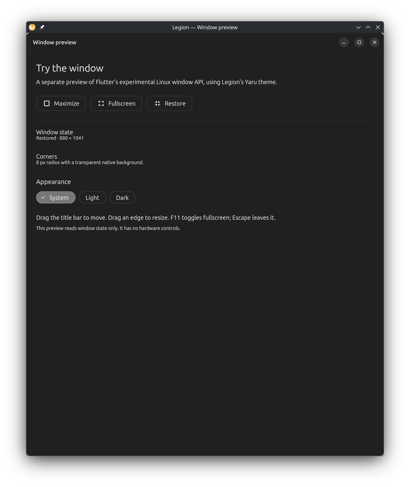

# Linux window preview

A small app for trying Flutter's experimental Linux window controls, using the
frontend's Yaru controls and balanced-mode colors. It reads the window's state
and offers maximize, fullscreen, restore, move, resize, and appearance controls.
It does not access laptop hardware or application settings.

## Run

Use a separate Flutter main/master checkout. These controls are available only
on that development channel;
having its source in stable 3.50 does not make it available there. This preview
uses Flutter revision `7f49251bab097db33a35967aa5af561f29c63db2` and Dart
`3.15.0-154.0.dev`.

From this directory, with that SDK on `PATH` and Linux build dependencies loaded:

```sh
flutter config --enable-windowing
flutter pub get --enforce-lockfile
flutter analyze
flutter run -d linux
```

For this session, the checkout is `/tmp/opencode/lllf-window-sdk`. From the
repository root:

```sh
nix-shell experiments/linux_window/shell.nix
export FLUTTER_ROOT=/tmp/opencode/lllf-window-sdk
export PATH="$FLUTTER_ROOT/bin:$PATH"
export HOME=/tmp/opencode/lllf-window-home
export PUB_CACHE=/home/prnice/.pub-cache
cd experiments/linux_window
flutter run -d linux
```

The separate home keeps the experimental feature flag out of the user's Flutter
configuration. The production SDK pin and app window integration are unchanged.
The preview shell adds the upstream engine's shared-library dependencies. The
production shell normally gets these paths through Nix's packaged Flutter SDK.
After changing that shell, run `flutter clean` and
`flutter pub get --enforce-lockfile` before rebuilding so CMake drops old library
paths.

## What worked and what still needs fixing

**Keep the app's current window controls.** The preview builds and opens on KDE
Wayland, but it shows an extra title bar and a startup timeout. Fullscreen
sizing still needs testing.

Checked on 18 November 2026 with the SDK revision above, Impeller, and the user's
KDE Wayland session with Karousel enabled. The native runner comes from
`flutter create --platforms=linux`; it has no app-specific native changes.

| Check | Result |
| --- | --- |
| Preview analysis and Linux debug build | Passed. |
| Root application analysis on stable | Passed. |
| Standard `flutter run -d linux --no-pub` | Built and opened the preview. |
| Startup | Flutter initially reported a window only 1 px wide. Waiting for its real size fixed the content overflow. The window system still reports a timeout while waiting for a frame. |
| Restored window | Yaru content rendered, but KDE still added a title bar despite `decorated: false`. |
| Maximize and restore | Maximizing and restoring through the desktop updated the displayed state and switched between square and rounded corners. |
| Fullscreen | The displayed state changed, but the screenshot still showed a narrow window. We have not confirmed that it fills the screen reliably. |
| Corner transparency | Rounded content corners are visible, but the extra title bar and border prevent us from confirming transparency at all four window corners. |



The desktop window manager chose the restored dimensions (880 × 1041 logical content
pixels), rather than the requested 880 × 620. Screenshots show the actual window;
they are not mockups. The capture predates the copy correction from
"with a transparent native background" to "native transparency requested": the
API request does not establish the rendered result. Local logs and captures are in
`/tmp/opencode/lllf-window-evidence`.

The final run still logged accessibility (ATK) errors, cursor-theme messages, and:

```text
Timed out waiting for subsurface frame of size 1760x1240 (have 0x0)
```

The visual check covered system-dark appearance and desktop-driven window
changes. Light appearance, every in-app button and shortcut, drag/resize gestures,
compact layout, startup frame timing, other desktops, and packaged launches remain
unverified. No automated test suite was added to this diagnostic package.

The extra title bar also appeared when calling `setDecorated(false)` after the
generic `WindowController` constructor. Creating `WindowControllerLinux` with
`decorated: false` did not resolve it. The cause has not been isolated between
the experimental API, GTK, and this desktop configuration.

## What to inspect

- Start the preview: one visible window should appear with its content ready.
- Inspect all four restored corners in light and dark modes: the clipped area
  should reveal the desktop rather than a black or opaque rectangle.
- Maximize: the window should fill the usable desktop with square corners.
- Enter fullscreen: the surface should fill the screen. Press Escape to leave.
- Restore: the previous window size and rounded corners should return.
- Drag the title bar and each edge: the compositor should move or resize the
  window. Resize to 420 × 500: actions should remain reachable by scrolling.

The preview rounds its Flutter content corners by 8 px. The new API lets it
request transparency and control the window; it does not draw Yaru title bars,
corners, shadows, or resize borders. Before using it in the main app, test the
full app and its normal installed and AppImage launches.

Sources: [Flutter's window API guide](https://docs.flutter.dev/blog/desktop-windowing-apis)
and the [Linux implementation at the tested revision](https://github.com/flutter/flutter/blob/7f49251bab097db33a35967aa5af561f29c63db2/packages/flutter/lib/src/widgets/_window_linux.dart).
